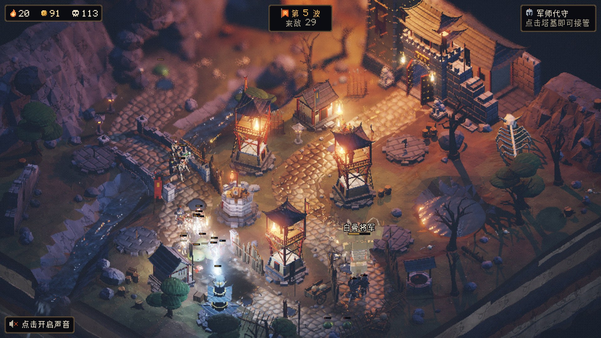

# 烽燧（Cinderwatch · 中式战争主题）

单个 HTML 文件里的自动对战 3D 等轴测塔防。边关守军点燃烽火，凭箭楼、火炮台、引雷塔与戍卒营，抵挡自山洞涌出的幽冥妖军。页面一打开，军师便代你守关，你随时可以接管。

本分支 `zh-war-theme` 把原版 [Cinderwatch](https://kevintngo.github.io/cinderwatch/) 的场景、建筑、单位、界面与音效整体换成了中式战争风格，玩法与数值未动。



## 改了什么

- **关隘。** 主城换成青砖城墙、拱门朱漆大门、双檐城楼、方形夯土烽火台和院内大殿，门前一对石狮。
- **四种防御，各三级，仍在脚手架里逐件搭起。**
  - 箭楼：砖台或夯土台、朱漆立柱、回廊栏杆，顶上是起翘的瓦顶（一级为茅顶）。
  - 火炮台：八角砖台加垛口，铜炮，挑杆上挂红灯笼。
  - 引雷塔：层层出檐的石塔，塔顶四爪托着一颗雷珠，三级时环绕八卦石环。
  - 戍卒营：夯土墙、粉墙或砖墙配悬山瓦顶，门口戟架，三级带角楼。
- **五处战场。** 雁门关、雪岭长城、云梦泽、赤壁、玉门关。新增松、竹、胡杨、红柳丛和赤壁的烧毁战船；道旁换成拒马、战鼓、兵器架、石灯、界碑和竖幅战旗；废塔换成残破烽燧，十字墓碑换成碑帽石碑。
- **敌我单位。** 守军是红衣铁甲、铜盔红缨的戍卒，配环首刀与方盾。人形敌军的模型全部重做：
  - 阴兵：束发髻、扎红头带的骷髅兵，披残破战裙与单肩锈甲，提环首刀；铁甲阴兵加铁胄红缨、札甲护心镜和兽面圆盾。
  - 僵尸：清代官帽官服、胸前补子，额贴黄符，双臂平伸、并腿蹦跳。
  - 招魂巫：高帽黑袍，手持招魂幡；火药鬼背着贴红签的火药坛；干尸穿金缕玉衣。
  - 怨灵：白衣长发的女鬼；石俑：束髻披甲的兵马俑；山魈一系：长角、挂念珠、围虎皮的夜叉。
  - 首领：白骨将军戴翎子铜盔、背插四面靠旗、提偃月刀；陵中尸王穿玉衣、戴冕旒、持青铜剑；另有雪魃、蛛后、熔岩巨俑、巨魈王。
  - 鼠、蝠、狼、蛛、蟾、瘴泥、鬼火、石夜叉这些兽类与精怪只改了名字，模型沿用原版。


- **战史回顾。** 每进入一处战场，左上角会出现一张短卡：此地发生过的战事与地形为何紧要，约 18 秒后自动收起，点击或按 `Esc` 可提前收起。内容在 `src/28-lore.js`。
- **中文界面。** 像素字体新增汉字支持：字形由 `tools/cjk.py` 从 Noto Sans CJK SC 栅格化成 12 px 与 16 px 点阵，嵌在代码里，离线可用。
- **音效。** 配乐改为 D 羽调式五声和声与拨弦筝音，紧张时是大鼓和梆子；每波来袭有三通鼓加号角，首领登场先响一声大锣。


仍然没有任何素材文件：模型、贴图、声音全部由代码生成。

## 操作

不操作也能看。你下达第一条指令后即由你督战，直到你把指挥权交还军师。

| 输入 | 动作 |
| --- | --- |
| 悬停塔基或防御 | 高亮并显示射程 |
| 点击空塔基 | 打开建造菜单 |
| 点击防御 | 升级或拆除 |
| `1` 至 `4` | 选择防御种类 |
| `U` | 升级悬停或选中的防御 |
| `X` | 拆除选中的防御 |
| 空格 | 提前迎接下一波 |
| `C`，或点击右上角指挥牌 | 交还或接管指挥 |
| `M` | 静音 |
| `Esc` | 关闭菜单 |
| 手柄 | 摇杆或十字键选塔基，A 打开并确认，B 关闭，X 升级，Y 提前迎敌 |

浏览器要等到一次点击或按键后才允许出声。

## 运行

直接打开 `index.html`。支持 `file://`，不需要服务器、构建或网络。

## 构建

```bash
python3 tools/cjk.py     # 只有改了界面里的中文才需要：重新生成 src/71-cjk.js
python3 tools/build.py   # 把 src/*.js 拼进 index.html，并内联 vendor/ 里的 three.js
```

`tools/cjk.py` 需要 Pillow 和 Noto Sans CJK 字体，字体路径可作为参数传入。

## 目录

| 路径 | 内容 |
| --- | --- |
| `index.html` | 构建好的游戏 |
| `src/00-util.js` | 数学、随机数、噪声 |
| `src/10-gfx.js` | 程序化贴图、光照材质、几何体构建器 |
| `src/12-china.js` | 中式建筑构件：起翘屋顶、斗拱带、垛口、灯笼、战旗 |
| `src/20-post.js` | 渲染器与后处理 |
| `src/28-lore.js` | 各战场的战史与地利回顾 |
| `src/29-biome.js` | 五处战场的色板、光照、天气与水体设置 |
| `src/30-layout.js`、`31-terrain.js`、`32-props.js`、`33-flora.js` | 道路与塔基布局、地形、关隘与道具、各战场的植被 |
| `src/40-fx.js`、`41-weather.js` | 灯光、粒子、闪电、贴花、雪、灰、沙尘与萤火 |
| `src/50-rig.js`、`51-bestiary.js` | 由实例化部件拼成的角色、碎块、后期敌人的模型 |
| `src/60-towers.js`、`61-monsters.js`、`62-game.js` | 防御工事、敌军与人群、波次与军师 AI |
| `src/70-pixelfont.js`、`71-cjk.js`、`72-ui.js` | 像素字体、汉字点阵（生成文件）、界面与输入 |
| `src/80-audio.js` | 合成音效与配乐 |
| `src/90-main.js` | 相机与主循环 |
| `tools/` | 构建脚本、汉字点阵生成脚本与测试工具 |

## 开发工具

`tools/cdp.js` 与 `tools/record.js` 驱动无头 Chrome，需要 Node 22 以上。Chrome 不在 macOS 默认位置时设置 `CHROME`，`ffmpeg` 不在路径里时设置 `FFMPEG`。在没有显卡的 Linux 上，把 `cdp.js` 里的 `--use-angle=metal` 换成 `--use-angle=swiftshader` 即可。

```bash
node tools/cdp.js "seed=4&ff=30" wait:2000 shot:battle eval:"__cw.G.lives"
```

URL 参数，例如 `index.html#seed=4&biome=fen`：

| 参数 | 作用 |
| --- | --- |
| `seed=N` | 固定战场与战局（从雁门关开始） |
| `biome=NAME` | 起始战场：`ashen` 雁门关、`frost` 雪岭长城、`fen` 云梦泽、`ember` 赤壁、`dunes` 玉门关 |
| `level=N`、`k=N` | 从后面的战场或波次开始 |
| `ff=S` | 第一帧前快进 S 秒 |
| `fps=1` | 显示帧率与绘制调用数 |
| `nodof=1` | 关闭移轴模糊 |
| `noscale=1` | 关闭自动分辨率缩放 |
| `manual=1` | 不启动主循环（供 `record.js` 使用） |

## 许可

游戏代码为 [MIT](LICENSE) 许可。构建产物内含 [three.js](https://threejs.org) r170（MIT，[声明](vendor/LICENSE-three.txt)），以及由 Noto Sans CJK SC 栅格化得到的汉字点阵（SIL Open Font License 1.1，[声明](vendor/LICENSE-noto-cjk.txt)）。
