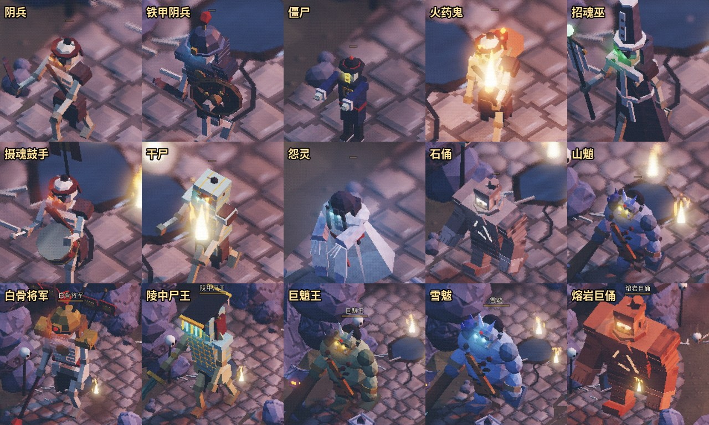

# 烽燧（Cinderwatch · 中式战争主题）

单个 HTML 文件里的自动对战 3D 等轴测塔防。边关守军点燃烽火，凭箭楼、砲车台、床弩台与戍卒营，抵挡来犯的敌军。敌我双方的每一种单位都出现在中国历代战争中。页面一打开，军师便代你守关，你随时可以接管。

本分支 `zh-war-theme` 把原版 [Cinderwatch](https://kevintngo.github.io/cinderwatch/) 的场景、建筑、单位、界面与音效整体换成了中式战争风格，玩法与数值未动。


## 改了什么

- **关隘。** 主城换成青砖城墙、拱门朱漆大门、双檐城楼、方形夯土烽火台和院内大殿，门前一对石狮。
- **四种防御，各四级，按朝代升级。** 箭楼、床弩台、戍卒营按秦 → 汉 → 唐 → 宋升级；砲车台秦代无可靠记载，改为汉 → 三国 → 唐 → 宋。每次升级仍在脚手架里逐件搭起，升级完成时弹出新兵种名称与一句史料介绍，升级面板里也会预告下一级。

| 防御 | 一级 | 二级 | 三级 | 四级 |
| --- | --- | --- | --- | --- |
| 箭楼 | 秦 · 弓弩前锋：兵马俑一号坑前锋三排弓弩手 | 汉 · 望楼弓手：烽燧望楼，居高放火箭 | 唐 · 强弩手：分番迭射 | 宋 · 神臂弓：射三百四十步，可穿重甲 |
| 床弩台 | 秦 · 连弩：《史记·秦始皇本纪》始皇于之罘以连弩射杀巨鱼 | 汉 · 大黄弩：李广以大黄弩射杀匈奴裨将 | 唐 · 车弩：《通典》绞轴张弦 | 宋 · 三弓床弩：七十人张发，射三百步 |
| 砲车台 | 汉 · 发石机：《汉书》注引《范蠡兵法》"飞石重十二斤，为机发，行二百步" | 三国 · 霹雳车：官渡之战曹操造发石车击袁绍楼橹（《三国志》） | 唐 · 抛车：唐军攻辽东，飞大石过三百步 | 宋 · 霹雳火砲：《武经总要》霹雳火球，以砲抛出 |
| 戍卒营 | 秦 · 锐士：兵马俑所见铆钉札甲、右侧发髻，持青铜戈 | 汉 · 戍卒：铁札甲、环首刀与盾 | 唐 · 陌刀手：明光铠、陌刀 | 宋 · 步人甲：重约二十九公斤，斩马刀 |

  砲车台原名"火炮台"，铜炮改为人力牵拉的砲车（配重抛石机出现于宋末元初，此前皆为人力拉砲）。

- **五处战场。** 雁门关、雪岭长城、云梦泽、赤壁、玉门关。新增松、竹、胡杨、红柳丛和赤壁的烧毁战船；道旁换成拒马、战鼓、兵器架、石灯、界碑和竖幅战旗；废塔换成残破烽燧，十字墓碑换成碑帽石碑。
- **敌军。** 原为阴兵、僵尸、妖兽等鬼怪，现已全部换成汉、唐、宋（含同期辽、金、西夏、突厥、匈奴）史上真实出现过的兵种，不再使用秦以前和明清的兵种。玩法机制（血量、速度、分裂、召唤等）基本不变：

| 单位 | 依据 |
| --- | --- |
| 步卒 | 历代步兵主力，手持汉代以来的制式环首刀 |
| 甲士 | 披札甲、戴铁胄、持盾的重装步兵，汉代称"甲士"，箭矢难伤 |
| 斥候 | 军前侦察的轻装胡人探子 |
| 先登死士 | 东汉末界桥之战，麴义领"先登"八百破公孙瓒；越伤越狠 |
| 轻兵 | 持矛的轻装步卒，随战车、战象冲阵，能绕过拦路的戍卒 |
| 跳荡兵 | 唐军跳荡：阵前突击的锐卒，一跃而进 |
| 伏兵 | 汉马邑之谋设伏诱匈奴；时隐时现，隐蔽时刀箭难伤 |
| 猛火油兵 | 五代、宋军以猛火油（石油）纵火；背油罐，近身即燃 |
| 战鼓手 | 击鼓进军，周围敌军随鼓加速 |
| 督战校尉 | 举令旗督阵的军官，校尉为汉代以来的武官名；会召来步卒 |
| 狼牙棒手 | 狼牙棒载于宋《武经总要》，宋金军中常用 |
| 云梯兵 | 扛云梯的攻城卒，箭矢较难伤；公输般为楚造云梯攻宋（《墨子·公输》） |
| 轻骑 | 匈奴、突厥等游牧骑兵，左衽皮袍、辫发胡帽、持弯刀 |
| 铁鹞子 | 西夏重骑，宋夏战争中屡破宋军 |
| 冲车 / 车卒 | 撞城车，宋《武经总要》有图；车毁后推车的车卒散出 |
| 轒辒车 / 填壕卒 | 蒙牛皮的攻城掩体车，《武经总要》载之；车毁后车内填壕的士卒散出 |
| 战象 | 南汉以象阵拒宋（971 年）；象倒后背上的轻兵四散 |
| 火禽 | 唐《太白阴经》：胡桃壳盛艾火系于野鸡颈下，放入敌营纵火 |
| 竹火鹞 | 宋《武经总要》：竹编纸糊，内装火药，抛入敌营 |
| 铁嘴火鹞 | 宋《武经总要》：木身铁嘴，尾束稻草，燃之掷敌 |

  各处战场的首领也按当地战史设定：

| 战场 | 首领 | 依据 |
| --- | --- | --- |
| 雁门关 | 突厥可汗、辽军大将 | 622 年颉利可汗寇雁门；980 年杨业于雁门大破辽军 |
| 雪岭长城 | 铁浮屠 | 金军重甲骑兵，1140 年郾城之战岳飞以麻扎刀破之 |
| 云梦泽 | 南汉象阵 | 971 年宋灭南汉，潘美以劲弩破象阵；会召来轻兵 |
| 赤壁 | 云车 | 高过城头的攻城楼车，昆阳之战（23 年）王莽军"云车十余丈"（《后汉书》）；起火后加速 |
| 玉门关 | 匈奴单于 | 汉匈百年战争，玉门关为汉通西域、御匈奴的门户；单于沿途召来轻骑 |



- **战史回顾。** 每进入一处战场，左上角会出现一张短卡：此地发生过的战事与地形为何紧要，约 18 秒后自动收起，点击或按 `Esc` 可提前收起。内容在 `src/28-lore.js`。
- **中文界面。** 像素字体新增汉字支持：字形由 `tools/cjk.py` 从 Noto Sans CJK SC 栅格化成 12 px 与 16 px 点阵，嵌在代码里，离线可用。
- **音效。** 配乐改为 D 羽调式五声和声与拨弦筝音，紧张时是大鼓和梆子；每波来袭有三通鼓加号角，首领登场先响一声大锣。


仍然没有任何素材文件：模型、贴图、声音全部由代码生成。

## 两个升级方向：换代与添兵

每座工事现在有两个升级方向，点开工事的面板，「升级」和「添兵」并排各一个按钮。

- **大升级（换代）。** 就是原有的按朝代升级：秦 → 汉 → 唐 → 宋，整座工事换装重建。按 `U`。
- **小升级（添兵）。** 不换兵器，只往这座工事里多派人。每座工事可以添两次，立刻生效，不用搭脚手架。按 `T`，或把鼠标停在工事上按 `T`。

| 工事 | 添兵一次 | 依据 |
| --- | --- | --- |
| 戍卒营 | 多一名戍卒出营拦路。默认两人（唐、宋三人），添满是四人或五人，多出的人排成第二列 | 古军制五人为伍：《周礼·夏官》"五人为伍"，《尉缭子·伍制令》"军中之制，五人为伍，伍相保也" |
| 箭楼 | 楼上多一名弓手，各自放箭 | 居延汉简所记边塞烽燧，一燧戍卒数人，轮番候望 |
| 床弩台 | 多一班张弩手，绞轴上弦快四分之一（添满约快到 1.8 倍） | 宋《武经总要》：三弓床弩以七十人张发，人手决定上弦快慢 |
| 砲车台 | 多一班拽手，伤害加四分之一（添满加一半） | 宋《武经总要》：单梢砲拽手四十人，七梢砲二百五十人；人力抛石机靠拽手齐拽，人多则石重 |

规则细节：

- **价钱跟着朝代走。** 给宋代工事添一个人比给秦代工事贵（例如戍卒营添一人：秦 30、汉 50、唐 60、宋 90 金；箭楼 50、75、75、105；床弩台 25、45、75、110；砲车台 20、40、65、95），第二次添兵再贵四分之一。
- **换代时驻军保留，但要一起换装。** 添过兵的工事再做大升级，价钱里会多出给这些人换装的钱，面板上的「升级」价已经算进去。先添兵还是先换代，总花费一样，不存在哪个顺序更省钱。
- **添兵也让工事更耐打。** 每添一次，工事耐久加 20%。
- **被首领摧毁后重建，驻军照原样回来；** 拆除时添兵的钱同样按六成退还。
- 军师代守时也会添兵，但只在塔基全部建满、且该工事已经升到当前能升的最高朝代之后，才把余钱花在添兵上。

规则和数值都在 `src/66-crew.js` 的 `CREW` 表里。上表史料凭记忆引用，未逐条核对原文。

**战力平衡。** 用 `tools/sim.js` 让军师自动打 48 个种子、每个种子连打六关。改动前失守 7/279 局，加入添兵后 10/276 局，过关时平均都剩 13.9 点城防，差别在种子之间的正常波动之内。军师只在后期用余钱添兵（第三关起平均每关 1.3 座工事添过兵），所以这组数字主要说明新规则没有打乱原有平衡。另外做过三组对照：全部工事免费添满时 24 个种子无一失守，说明添兵本身确实增强战力；按「与新建一座工事同价」定价、并让军师优先添兵而不是换代时，24 个种子失守 9 到 12 局，说明添兵不如换代和多建划算，于是把添兵价钱下调约三成，并让军师先建满、先换代。结论是添兵是名副其实的小升级：便宜、见效快，适合塔基已满或暂时升不了代的时候用，但替代不了换代。

## 攻城与城头守军

漏过防线的敌军不再直接穿门而入。他们在关城下集结，照真实攻城战的两条路打进来：撞破城门，或者架云梯登城。上了城墙就与守军肉搏，守军会阵亡。

- **城门。** 城门有耐久，一级守军时为 130，随守军升级到 175、225、290。城下的敌军都在撞门，但刀斧手每秒只磨掉 1 点，真正破门靠器械：冲车每秒 9 点，战象 6 点，轒辒车 3.5 点，首领 6 至 8 点；猛火油兵冲到门下自燃，一次烧掉 32 点。城下没有敌人满 5 秒后守军开始抢修，修回三成半城门重新关上。城门平时紧闭，两扇朱漆门钉大门合拢；被撞破后一扇倒在门前、一扇焦黑斜挂，修复后重新合上。

- **失守。** 城防归零、关城失守时，城门洞开，东侧城墙塌出一道缺口，碎砖滚到墙外，残垣起火，城头剩下的守军阵亡，门楼两侧的旗换成敌军的黑旗。
- **云梯。** 云梯兵扛梯走在队伍中段，到城下离开大路，把梯子架上东墙，最多同时三架。梯子立着的时候，城下的步卒一次一人往上爬，先登死士优先而且爬得最快。射死扶梯的云梯兵，梯子就倒，梯上的人摔死。每个战场从第三波起必有云梯兵，越往后的战场越多。
- **登城。** 城门一破，门前的敌军涌进门洞：步卒从马道上城墙杀守军，骑兵、器械、战象和首领直接冲进城里。
- **守军。** 开局城头 2 名弩卒，最多 8 名，每人有生命值。他们优先射已经上墙和正在爬梯的敌人，其次是扶梯的云梯兵，再次是撞门的敌人，也射飞行之敌。被敌人贴身时拔刀肉搏。城头没有敌人时慢慢回血。
- **城防。** 左上角火焰旁的数字，满值 20，归零则关城失守。只有冲进城里的敌人才扣城防：城墙上已经没有守军可杀的登城步卒、从破门冲进去的骑兵器械和首领，扣的点数与原版漏怪相同。火禽和火鹞照旧飞越城头直接烧城。
- **增兵（技能）。** 按 `R` 或点底部面板，固定花 70 金，城头立刻多一名守军。守军阵亡后靠它补充。
- **升级守军。** 按 `G` 或点底部面板，守军按朝代整体换装，共四级，花费 140、200、280 金，同时加固城门。

| 等级 | 守军 | 依据 | 伤害 | 生命 | 射程 |
| --- | --- | --- | --- | --- | --- |
| 一级 | 秦 · 城上弩卒 | 《墨子·备城门》守城之法"二步一木弩，必射五十步以上"；《墨子》成书于战国，秦代沿用属推断 | 7 | 50 | 5.6 |
| 二级 | 汉 · 塞上燧卒 | 居延汉简所记边塞戍卒；甲渠候官等遗址出土"转射"，即嵌在坞壁上的转动射孔 | 9 | 64 | 6.0 |
| 三级 | 唐 · 睢阳守卒 | 757 年睢阳之战，张巡、许远以数千人守城十月 | 11 | 80 | 6.5 |
| 四级 | 宋 · 钓鱼城守军 | 1243 至 1279 年钓鱼城坚守三十六年，1259 年蒙哥汗殁于城下 | 14 | 100 | 7.0 |

攻城时各兵种的分工，都取自战史：

| 兵种 | 攻城时做什么 | 依据 |
| --- | --- | --- |
| 云梯兵（新增） | 架云梯，让步卒登城 | 《墨子·公输》公输般为楚造云梯以攻宋；《墨子·备梯》专讲如何破云梯；宋《武经总要》有云梯、飞梯图 |
| 步卒、甲士、轻兵、车卒等步兵 | 撞门，爬云梯登城肉搏 | 《孙子·谋攻》"将不胜其忿而蚁附之"，蚁附即士卒攀城 |
| 先登死士 | 最先、最快爬上城墙 | "先登"本义就是第一个登上敌城，历代列为头等军功 |
| 跳荡兵 | 爬梯快 | 唐军跳荡为突击锐卒 |
| 冲车 | 破门主力 | 《诗经·大雅·皇矣》"与尔临冲，以伐崇墉"；《武经总要》有撞车图 |
| 轒辒车 | 掩护士卒抵近撞门 | 《孙子·谋攻》"修橹轒辒，具器械，三月而后成" |
| 猛火油兵 | 火烧城门 | 火攻城门历代常见；宋《武经总要》载猛火油柜 |
| 战象 | 撞门 | 南汉象阵见前；以象撞门属推断 |
| 轻骑、铁鹞子 | 不能登城，门破后冲进城里 | |
| 火禽、火鹞 | 飞越城头纵火 | 见前表 |

**战力平衡。** 四种防御的四级数值重新排过：一级与改动前的原版一级相同，四级略强于原版的满级，升满的总价比原版高约两成。军师也会在敌军登城、城门受损、守军阵亡时增兵和升级守军。用 `tools/sim.js` 让军师自动打 48 个种子、每个种子连打六关：新规则下各关失守 13/246 局，过关时平均剩 11 至 15 点城防；改成史实兵种之前的原版为 9/254 局，平均剩 11 至 15 点。军师布防较严，按过关的局统计，约两成的关卡城门被撞破过，约一成的关卡有敌人登上城墙。

## 战役顺序与兵种解锁

五处战场按守御难度由易到难排成五关。史书对这些战役并没有统一的难度定论，这里的排序依据四项史料可考的标准：敌我兵力对比、守方可凭的地利、粮援远近、守御的实际结局。

| 关 | 战场 | 排在此位的理由 | 守住后解锁 |
| --- | --- | --- | --- |
| 一 | 雁门关 | 李牧备边多年，以逸待劳，一战破匈奴十余万骑，此后十余年匈奴不敢近边（《史记·廉颇蔺相如列传》）。守方占尽地利，代价最小。 | 砲车台 |
| 二 | 赤壁 | 孙刘约五万人当曹军二十余万（《三国志·周瑜传》及裴注），众寡悬殊；但有大江之险，北军不习水战又染疾疫。以寡敌众而胜。 | 床弩台 |
| 三 | 玉门关 | 孤悬河西尽头，粮援难继；李广利首征大宛，还至敦煌士卒十不存一二（《史记·大宛列传》）。关守住了，代价极重。 | 唐代军制 |
| 四 | 云梦泽 | 泽国平阔，无险可凭。前 278 年白起破郢，楚失其都，东迁于陈（《史记·白起王翦列传》）。守方以失败告终。 | 宋代军制 |
| 五 | 雪岭长城 | 金以精兵守居庸，冶铁锢门，布蒺藜百余里，仍被蒙古绕道紫荆关、南北夹击而破（《元史·札八儿火者传》）。天险与重兵俱全仍然失守。 | 进入第二轮 |

- 开局只有箭楼与戍卒营，各线和城头守军最高升到汉。李牧守雁门正是靠射手与步卒。
- 砲车台在赤壁一关可用，汉级升一级即官渡霹雳车，与赤壁同世。床弩台在玉门关一关可用，汉级即居延、敦煌汉简所记的大黄弩。
- 唐、宋两代军制依次在第四、第五关开放。宋代军制与 1213 年的居庸之战同世；云梦泽一关用唐制没有战史上的对应，只是顺着朝代先后排下来的。
- 游戏原本按兵种齐全来定数值，所以前四关的敌军数量与生命按比例削减（`src/64-campaign.js` 的 `ease`），第五关与此后各轮为原强度。
- 解锁永久保留；失守后重守本关，不再退回第一关。进度存在浏览器本地，URL 加 `#reset` 清除，加 `#unlock` 全部解锁并取消削减。
- 未解锁的工事在建造菜单里标「未解」，升级按钮写明要先守住哪一关。每关的排序理由显示在战史短卡的「守难」一栏。

## 首领袭击沿路工事

每处战场第五波的首领不再只是从塔下走过。他行军途中会主动攻击道路两旁的箭楼、床弩台、砲车台和戍卒营，规则在 `src/64-raid.js`。

- **工事有耐久。** 四种工事各有耐久，随朝代升级而增厚：箭楼 90 / 120 / 160 / 210，床弩台 110 / 145 / 190 / 250，砲车台 130 / 170 / 220 / 290，戍卒营 140 / 180 / 240 / 310。受损的工事头顶出现耐久条，低于六成开始冒烟。
- **抢修。** 6 秒内没有再挨打，守军自行抢修，每秒回复半成耐久，不花钱。
- **被毁与重建。** 耐久归零，工事塌成一堆燃烧的废墟，停止作战；戍卒营被毁后，已在路上的戍卒继续死战，但不再补员。点击废墟，花原造价（含升级）的三成即可原级重建，约两秒建成。拆除废墟只退三成。
- **戍卒护塔。** 首领被戍卒缠住时只顾砍杀戍卒，腾不出手打工事。把戍卒营放在要保护的工事前面，是最便宜的防法。
- **升级更耐打。** 重击型首领每座工事只打三下，一、二级工事大多撑不住，三、四级通常能残存下来等抢修。

各首领的打法取自其战史：

| 首领 | 打法 | 依据 |
| --- | --- | --- |
| 突厥可汗 | 行进中每 2.4 秒向 5.6 格内最近的工事齐射三支火箭 | 《周书·突厥传》：兵器有弓矢、鸣镝；可汗侍卫称"附离" |
| 匈奴单于 | 同上，火箭略重 | 《史记·匈奴列传》：冒顿作鸣镝，"鸣镝所射而不悉射者，斩之" |
| 云车 | 居高临下，每 2.6 秒向 6.4 格内的工事射四支火箭 | 《后汉书·光武帝纪》昆阳之战："云车十余丈，瞰临城中……积弩乱发，矢下如雨" |
| 辽军大将 | 停步转身，挥刀连劈三下，然后继续行军，5 秒后再找下一座 | 《辽史·兵卫志》：辽军行军"沿途民居、园囿、桑柘，必夷伐焚荡" |
| 铁浮屠 | 停步冲撞三下；原有的震地使周围工事停火依旧保留 | 《宋史·刘锜传》顺昌之战：铁浮图重铠，"三人为伍，贯以韦索"，专用于攻坚 |
| 南汉象阵 | 停步，战象撞踏三下 | 《宋史·潘美传》：南汉"教象为阵，每象载十数人，皆执兵仗，凡战必置阵前" |

首领的破坏力每过一处战场加一成二。骑射型首领边走边射，略为减速；重击型首领打工事时停在原地，等于多挨一轮箭矢，这是有意的代价：打掉工事和多挨打两相抵消。用 `tools/sim.js` 跑 24 个种子、每个 6 处战场：加入本功能前后都是 7 个种子中途失守，每场首领战平均毁掉 1 至 2 座工事。

军师代守时会优先重建废墟。

## 敌军的打法：先头部队、偷袭、总攻、号令三军、积功晋级

敌军不再只是一波波沿大路走过来。规则与数值都在 `src/65-foe.js`，其他文件只留了一行钩子。

- **先头部队。** 每一波攻城部队出发前约 6 秒，先头部队先行，专打大路两旁的工事。横幅会报出这一波先头部队的人数。
  - **选锋**举火把离开大路，走到工事脚下劈砍纵火，每人最多砍 8 下，一座工事同时最多挨两人；工事被毁或砍够了就回到路上去找下一座。戍卒会出营迎击正在砍自家工事的选锋。
  - **拦子马**从第二波起出现，骑在马上沿路放火箭射工事，每 2.3 秒一箭。
  - 先头部队占用本波的一部分兵力预算，主力相应略少。
- **偷袭。** 从每关第二波起（第一关从第三波起），每波有三成机会（越往后的战场越高，最多五成）出一支奇兵：不走大路，从战场边缘翻上来，走直线间道插到大路的中后段，绕过前面的工事。出现前 3.5 秒有横幅和地面光圈示警，光圈标出入口和汇入大路的位置。奇兵由选锋带队，其余是斥候、轻兵、先登死士、轻骑。间道避开水面、陡坎、塔基和两端的营垒；找不到合适间道的地图不出偷袭。
- **集结与总攻。** 第五波首领登场时，主力不再陆续上路，而是先在敌营门口列阵约 11 秒（横幅"集结大军"），然后全军一齐压上（横幅"总攻"），头 5 秒冲得更快。列阵时前排已在近处工事的射程内，可以趁其未集先打。首领波的兵力预算由原来普通波的七成提到八成。
- **号令三军。** 首领走进城头守军的射程后停步举旗，身后立刻出现一支带云梯的攻城部队（第二关起加一辆冲车）。他自己在射程边缘督战，直到这支部队打光或过了 26 秒才亲自上前撞门。为了让首领通常能活着走到城下，首领生命提到原来的 1.8 倍；随首领沿路增援的小队由 9 批减为 3 批。
- **积功晋级。** 敌兵每杀我方一名戍卒或城头守军记一功，选锋烧毁一座工事记两功。满 1、3、6 功依次升什长、百长、千长：每级生命加三成、伤害加两成半、身形略大，背后插一面小旗（铜、银、金三色）。首领不晋级。

| 新增 | 依据 |
| --- | --- |
| 选锋 | 《孙子·地形》"兵无选锋，曰北"；南宋诸屯驻大军设选锋军，为挑选出的先锋锐卒 |
| 拦子马 | 《辽史·兵卫志》：辽军出征，选骁勇三千为先锋军，又选剽悍百人以上为远探拦子军；宋人称之为拦子马 |
| 偷袭 | 263 年邓艾自阴平行无人之地七百余里入蜀（《三国志·邓艾传》）；817 年李愬雪夜袭蔡州；1213 年蒙古绕道紫荆关破居庸 |
| 号令三军 | 《周礼·夏官》"大国三军"，后世以三军泛指全军；攀城称"蚁附"，见《孙子·谋攻》 |
| 什长、百长、千长 | 《史记·匈奴列传》："诸二十四长亦各自置千长、百长、什长" |

以上引文凭记忆写出，未逐条核对原书。

**战力平衡。** 并入名将可阵亡、集合号角与暂停之后，用 `tools/sim.js` 让军师自动打 16 个种子、每个种子连打六关：改动前失守 1 局；改动后失守 2 局，过关时平均剩 13 至 15 点城防，约 45% 的首领波打出了号令三军，每关平均有两三座工事被选锋烧毁。军师在首领波会更早给城头增兵。

## 地图、画面与塔基

- **地图扩大。** 战场边长由 36 加到 48，面积多出约 78%。道路随之加长，由 58 至 92 变为约 81 至 129；塔基由每图 8 至 11 处增到 11 至 15 处。山崖、关城、敌军出发的山口仍贴着原来的两条边，树木、石块、道具按面积或路长补足，密度不变。
- **去掉模糊。** 试玩时的模糊有两个来源，都已去掉。一是移轴景深：画面近处和远处（包括关城）被一道 40 次采样的模糊糊掉，这道后处理已整段删除，全场清晰。二是分辨率：原先场景只按窗口一半的高度绘制再放大，现在按窗口原生分辨率绘制，最高 1080 行。删掉景深省下的开销大致抵掉了提高分辨率的开销；机器吃力时仍会像以前一样自动降低分辨率。低处的薄雾、火光的辉光和颗粒感保留。
- **镜头。** 地图大了，一屏看不全：镜头仍自动跟随战况，另可用滚轮缩放，按住右键或中键拖动、或按方向键平移；平移后镜头停在原处，按 `0` 或 `Home` 交还自动跟随。
- **塔基一眼可辨。** 塔基原是深色的八角石台，四周围着碎石，颜色和地面的石头一样，容易混在地形里。现在是一座方形台基：浅色条石台身、朱红边框、深色铺地、中央一枚铜钉，朝路的一侧有两级台阶。五处战场的地形里都没有方正、浅色、带红边的东西，所以一眼就能认出。空着的塔基另插一面杏黄旗，台面有一圈缓缓明灭的金色光框（由你督战时更亮）；建起防御后旗和光框消失，红边台基留在塔脚下。
- **难度。** 敌军出兵的节奏不变，路更长只是让各波在路上拉得更开，每座防御面对的敌军流量不变。用 `tools/sim.js` 让军师自动打 32 个种子、每个种子连打六关：扩大后失守 8/177 局，过关时平均剩 11.3 点城防；扩大前同样的种子为 9/165 局，平均剩 12.5 点。数值未作调整。
- **顺带修了一处卡关。** 一波只剩扶梯的云梯兵、而城头守军射不到他们或已全部阵亡时，这一波永远不会结束。现在所有还活着的敌人都只是在扶梯时，扶梯的云梯兵等 6 秒后自己登城。

## 历史名将与战后策勋

每一战有一位名将出战，在大路后半段迎敌：敌人到哪里他就赶到哪里，头顶标着名字和生命条。技能在冷却好、敌人够密或首领逼近时自动施放。右上角的名将牌显示三项技能的状态；按 `H` 或点这块牌子打开名将榜，可以换人出战、查看史料和加点。战斗中换将，新上场者的技能从头冷却。

| 名将 | 兵种 | 技能一（自带一级） | 技能二 | 技能三 |
| --- | --- | --- | --- | --- |
| 霍去病，西汉骠骑将军 | 骑兵，持矛近战 | 轻骑奔袭：沿大路冲阵，沿途之敌受伤并被撞退。元朔六年率轻勇骑八百弃大军数百里赴利；元狩二年转战六日，过焉支山千有余里 | 取食于敌：亲手斩杀之敌赏金增加。武帝诏书称其「取食于敌，逴行殊远而粮不绝」 | 封狼居胥：对首领伤害增加，首领伏诛时回复城防。元狩四年封狼居胥山，禅于姑衍，登临翰海 |
| 白起，秦武安君 | 步战，秦甲持戈 | 伊阙斩首：残血之敌一击斩杀。前 293 年伊阙之战斩首二十四万 | 水灌鄢城：引水冲灌一段大路，伤敌并使其迟滞。前 279 年引西山长谷水灌鄢 | 长平绝粮：新到之敌生命降低。前 260 年长平之战断赵军粮道四十六日 |
| 岳飞，南宋 | 骑兵，持枪近战 | 麻扎刀：对骑兵伤害增加并使其迟滞。1140 年郾城之战以麻扎刀砍马足，破拐子马 | 背嵬陷阵：身周之敌受伤并被击退，随后出手加快。背嵬军为岳飞亲军，郾城、颍昌两战冲阵 | 撼山易：城头守军与戍卒持续回复生命。「冻死不拆屋，饿死不卤掠」「撼山易，撼岳家军难」 |
| 李陵，西汉骑都尉 | 步战弓手，可射飞行之敌 | 千弩俱发：向射程内多个敌人齐射。浚稽山之战「千弩俱发，应弦而倒」 | 连弩射单于：重矢射向生命最多之敌并使其迟滞。「发连弩射单于，单于下走」 | 矢尽死战：城防损失越多射速越快。一日五十万矢皆尽，士卒仍持尺刀死战 |

出处：霍去病见《史记·卫将军骠骑列传》；白起见《史记·白起王翦列传》，水灌鄢城见《水经注·沔水》；岳飞见《宋史·岳飞传》；李陵见《汉书·李广苏建传》与司马迁《报任安书》。各技能的数值与完整说明在名将榜里，数据在 `src/64-hero.js` 的 `HEROES`。白起是战国秦将，早于敌军所用的汉、唐、宋史料，属于我方名将的例外。

**操控名将。** 名将是战场上的单位，默认由军师调度。按 `Q` 或直接点名将选中他，再点大路上任意一处，他就赶去那里驻守，只打走到跟前的敌人；按 `E` 交还军师调度。下令即视为你亲自督战。

**受击与阵亡。** 走到名将跟前的敌人会停下来围攻他，同时至多三人，首领不受此限。名将生命为霍去病 900、白起 1100、岳飞 1000、李陵 650，每过一关加两成；6 秒未受伤后每秒回复 2.5%。军师调度时，生命低于三成会退到城门下休整，回到六成再上；听令驻守时不会自己后退。生命耗尽即阵亡，三种办法归队：

| 办法 | 说明 |
| --- | --- |
| 花金币 | 按 `V` 或点名将牌上的复活按钮，花 100 金（每过一关加 40），立刻在城门下复活 |
| 等待 | 阵亡 150 秒（两分半）后自动归队 |
| 过关 | 打完这一关，下一处战场开局时照常出战 |

阵亡期间名将的技能全部失效；复活后技能从头冷却。军师代守时，金币宽裕就会替你花钱复活。

**集合号角。** 四位名将都有，不用加点。名将在场时按 `B` 吹角，各戍卒营的士卒离开本营，沿大路跑到城墙下列阵，与攻城之敌厮杀 40 秒，然后各回本营；冷却 75 秒。名将阵亡则号角中止。军师代守时，敌军开始攻城就会自动吹角。依据：《孙子·军争》引《军政》「言不相闻，故为金鼓；视不相见，故为旌旗」，军中以鼓角旌旗聚众。

**技能加点。** 每项技能三级，升到第一、二、三级分别花 1、2、3 转勋。勋转只能靠战后策勋得到，四位名将共用。名将榜里可以随时「重新分配」，退还全部勋转。勋转与加点存在浏览器的 localStorage 里，换局、战败都保留。

**战后策勋。** 诛灭首领、关隘无恙之后弹出策勋榜，仿唐代军功叙勋之制评定（《唐六典·尚书兵部》以敌我众寡分上阵、中阵、下阵，以杀获多少分上获、中获、下获，两项合计酬勋若干转；这里做了简化）：

| 项目 | 上 | 中 | 下 |
| --- | --- | --- | --- |
| 阵：过关时的敌势倍数（守得越稳敌势越强，相当于以少击多） | 2 倍以上 | 1.5 倍以上 | 不足 1.5 倍 |
| 获：斩敌数 ÷（斩敌数 + 抵达城下的敌数） | 99% 以上 | 96% 以上 | 不足 96% |

上阵上获酬勋 5 转，阵或获每降一等少 1 转，下阵下获 1 转；城防无损且城门未破，另加 1 转。关城失守不叙功。亲自督战时策勋榜会一直等你点「继续」；军师代守时 14 秒后自动收榜，勋转留着等你来分配。

## 操作

不操作也能看。你下达第一条指令后即由你督战，直到你把指挥权交还军师。

| 输入 | 动作 |
| --- | --- |
| 悬停塔基或防御 | 高亮并显示射程 |
| 点击空塔基 | 打开建造菜单 |
| 点击防御 | 升级或拆除 |
| `1` 至 `4` | 选择防御种类 |
| `U` | 大升级（换代）：升级悬停或选中的防御 |
| `T` | 小升级（添兵）：给悬停或选中的防御增派驻军 |
| `X` | 拆除选中的防御 |
| 空格 | 提前迎接下一波 |
| `R` | 增兵：花 70 金，城头多一名守军 |
| `H`，或点击右上角名将牌 | 打开名将榜：换将、看史料、技能加点 |
| `Q`，或点击名将 | 选中名将；选中后点大路上一处，名将去那里驻守 |
| `E` | 名将交还军师调度 |
| `B` | 集合号角：召戍卒营士卒到城墙下 |
| `V` | 名将阵亡后花金币复活 |
| `G` | 升级城头守军 |
| `F`，或点击左下角快进牌 | 快进：常速 → 2 倍 → 4 倍循环 |
| `P`，或点击左下角暂停牌 | 暂停 / 继续；暂停时仍可建造、升级 |
| `C`，或点击右上角指挥牌 | 交还或接管指挥 |
| 滚轮 | 缩放镜头 |
| 右键或中键拖动、方向键 | 平移镜头 |
| `0`、`Home` | 镜头交还自动跟随 |
| `M` | 静音 |
| `Esc` | 关闭菜单 |
| 手柄 | 摇杆或十字键选塔基，A 打开并确认，B 关闭，X 升级，Y 提前迎敌，LB 增兵，RB 升级守军 |

浏览器要等到一次点击或按键后才允许出声。

## 运行

直接打开 `index.html`。支持 `file://`，不需要服务器、构建或网络。

## 构建

```bash
python3 tools/cjk.py     # 只有改了界面里的中文才需要：重新生成 src/71-cjk.js
python3 tools/build.py   # 把 src/*.js 拼进 index.html，并内联 vendor/ 里的 three.js
```

`tools/cjk.py` 需要 Pillow 和 Noto Sans CJK 字体，字体路径可作为参数传入。

## 目录

| 路径 | 内容 |
| --- | --- |
| `index.html` | 构建好的游戏 |
| `src/00-util.js` | 数学、随机数、噪声 |
| `src/10-gfx.js` | 程序化贴图、光照材质、几何体构建器 |
| `src/12-china.js` | 中式建筑构件：起翘屋顶、斗拱带、垛口、灯笼、战旗 |
| `src/20-post.js` | 渲染器与后处理 |
| `src/28-lore.js` | 各战场的战史与地利回顾 |
| `src/29-biome.js` | 五处战场的色板、光照、天气与水体设置 |
| `src/64-campaign.js` | 战役顺序、各关排序理由、兵种解锁表与前几关的强度削减 |
| `src/30-layout.js`、`31-terrain.js`、`32-props.js`、`33-flora.js` | 道路与塔基布局、地形、关隘与道具、各战场的植被 |

| `src/30-layout.js`、`31-terrain.js`、`32-props.js`、`33-flora.js` | 地图尺寸、道路与塔基布局、地形、关隘与道具、各战场的植被 |
| `src/34-pads.js` | 塔基的台基模型与空塔基的光框 |
| `src/40-fx.js`、`41-weather.js` | 灯光、粒子、闪电、贴花、雪、灰、沙尘与萤火 |
| `src/50-rig.js`、`51-bestiary.js`、`52-army.js` | 由实例化部件拼成的角色与碎块；敌军的兵种、坐骑、攻城车、战象与火器模型 |
| `src/60-towers.js`、`61-monsters.js`、`62-game.js` | 防御工事、敌军与人群、波次与军师 AI |
| `src/63-wall.js` | 城头守军、增兵技能与敌军攻城 |
| `src/64-raid.js` | 首领袭击沿路工事：工事耐久、抢修、被毁与重建 |
| `src/64-hero.js` | 历史名将、技能、战后策勋与名将榜 |
| `src/70-pixelfont.js`、`71-cjk.js`、`72-ui.js` | 像素字体、汉字点阵（生成文件）、界面与输入 |
| `src/80-audio.js` | 合成音效与配乐 |
| `src/90-main.js` | 相机与主循环 |
| `tools/` | 构建脚本、汉字点阵生成脚本与测试工具 |

## 开发工具

`tools/sim.js` 让军师在无头 Chromium 里自动对局，用来比较平衡：`node tools/sim.js $PWD/index.html 1,2,3 6` 表示种子 1 至 3 各连打六关，需要 Playwright。

`tools/cdp.js` 与 `tools/record.js` 驱动无头 Chrome，需要 Node 22 以上。Chrome 不在 macOS 默认位置时设置 `CHROME`，`ffmpeg` 不在路径里时设置 `FFMPEG`。在没有显卡的 Linux 上，把 `cdp.js` 里的 `--use-angle=metal` 换成 `--use-angle=swiftshader` 即可。

```bash
node tools/cdp.js "seed=4&ff=30" wait:2000 shot:battle eval:"__cw.G.lives"
```

URL 参数，例如 `index.html#seed=4&biome=fen`：

| 参数 | 作用 |
| --- | --- |
| `seed=N` | 固定战场与战局（从雁门关开始） |
| `biome=NAME` | 预览某处战场（不改变关数）：`ashen` 雁门关、`frost` 雪岭长城、`fen` 云梦泽、`ember` 赤壁、`dunes` 玉门关 |
| `level=N`、`k=N` | 从第 N+1 关或某一波开始 |
| `unlock`、`reset` | 全部解锁并取消前几关的削减；清除本地战役进度 |
| `ff=S` | 第一帧前快进 S 秒 |
| `fps=1` | 显示帧率与绘制调用数 |
| `cam=X,Z,缩放` | 把镜头固定在某处，供截图使用 |
| `noscale=1` | 关闭自动分辨率缩放 |
| `manual=1` | 不启动主循环（供 `record.js` 使用） |

## 许可

游戏代码为 [MIT](LICENSE) 许可。构建产物内含 [three.js](https://threejs.org) r170（MIT，[声明](vendor/LICENSE-three.txt)），以及由 Noto Sans CJK SC 栅格化得到的汉字点阵（SIL Open Font License 1.1，[声明](vendor/LICENSE-noto-cjk.txt)）。
